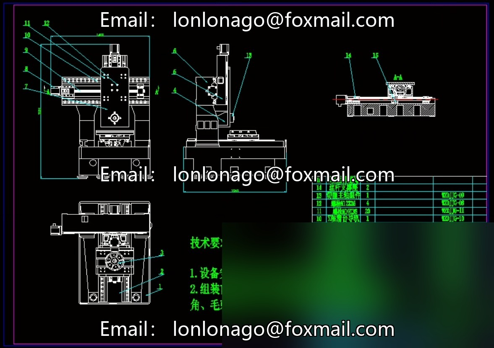
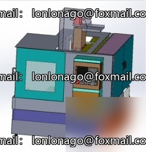
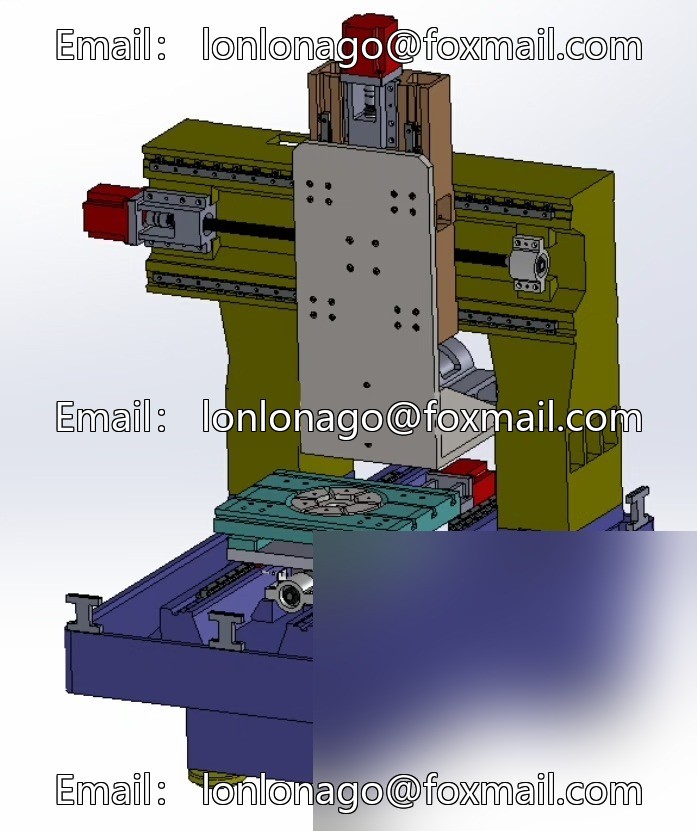
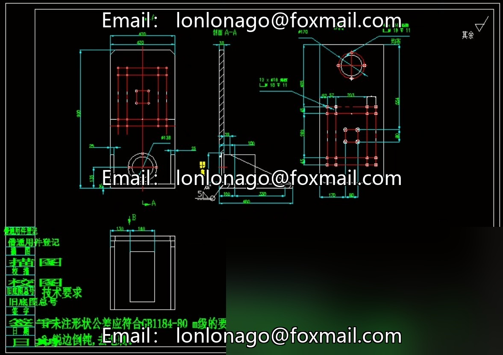
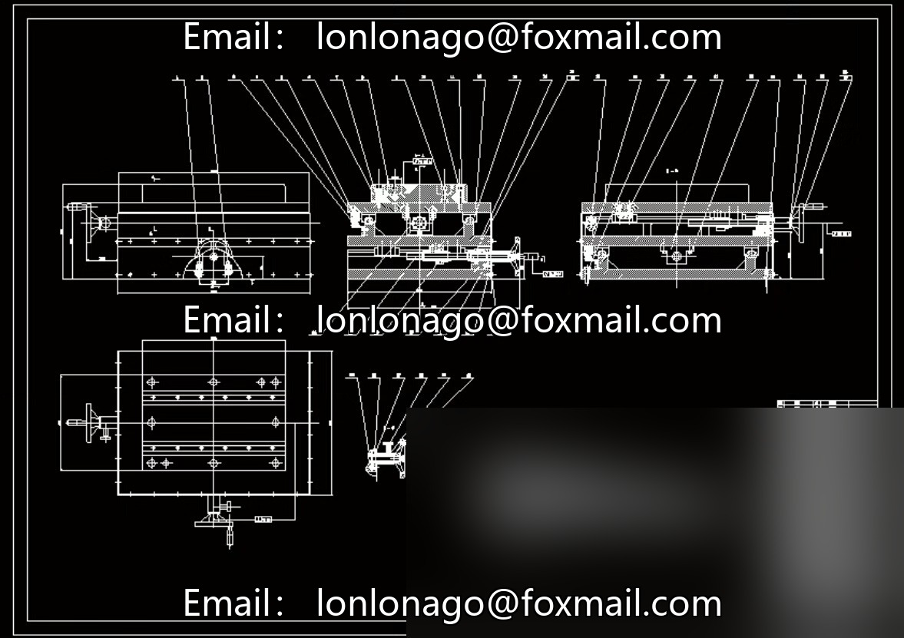
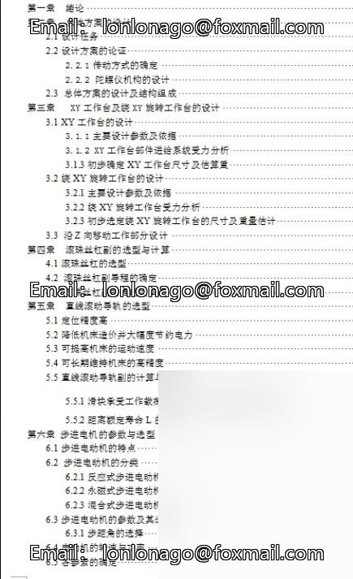

# 5-axis 4-linked CNC electro machining machine design 5-axis linkage machine bed spindle design 5-axis 4-linked

## Body

5-axis 4-linked CNC electrolytic machining machine design; 5-axis coupling machine bed main shaft design; 5-axis 4-linked CNC electrolytic machining machine design drawing; 5-axis 4-linked CNC electrolytic machining machine design CAD drawing
122    The five-axis joint machine bed axis model, based on the XY workbench, adds two layers of platforms. The step motor drives the axis to make rotation motion, forming a structure similar to a gyroscope. It separately realizes the workbench's rotation and movement around the XY axis, and then assembles a screw along the Z-axis to complete the workbench's up-and-down motion along the Z-axis, ultimately achieving that the tool is processed toward each surface. It mainly completed: the overall structural design of the model, structural design and calculations of each axis, the selection and strength analysis of ball screws, bearings, and straight scroll rails; the selection and analysis of the step motor.

The design covers the structural design of a five-axis four-link CNC electrolytic processing machine, the main shaft model, transmission systems, ball screws, linear rolling guides, and step motor parameter selection.

<!-- AI_ENRICHED -->

## Images

## Payment

Here is a pay link on Stripe ( https://buy.stripe.com/3cs8yP7sY87d0vu9AB ). Please contact me lonlonago@foxmail.com after funding $89, and I will send you a complete data files , thank you!

